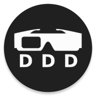
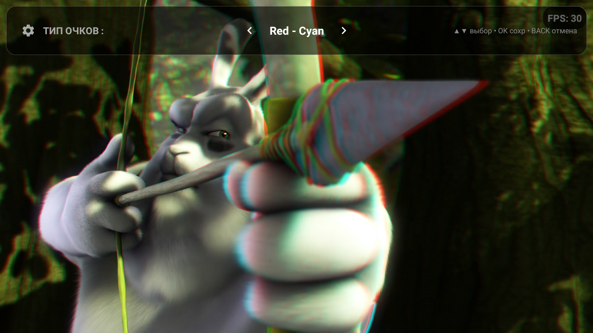
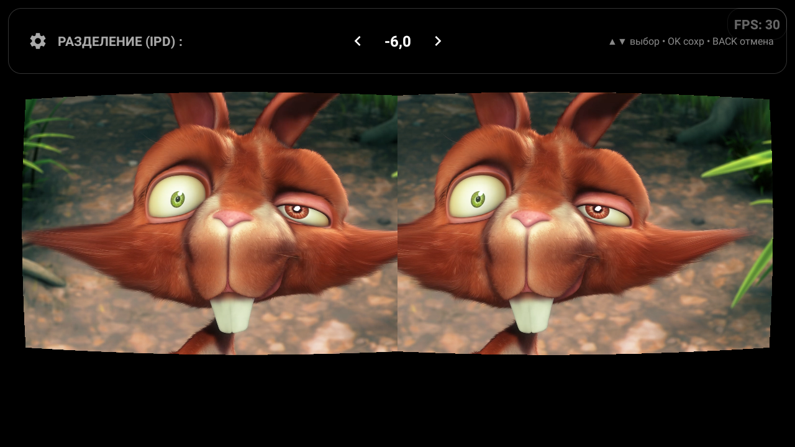
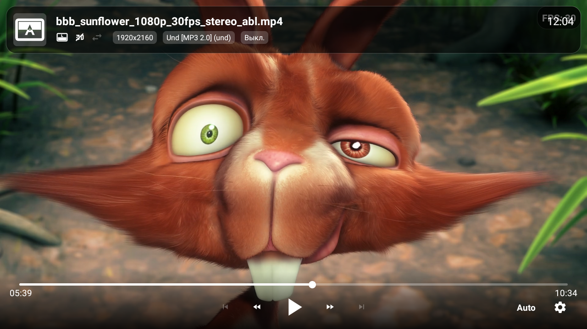

<div align="center">
  
  <h1>DDD Video Player</h1>

  <p>
    <a href="LICENSE">
      
    </a>
    <a href="https://github.com/usmanec/dddplayer/actions/workflows/android-build.yml">
      
    </a>
    <a href="README_RU.md">
      
    </a>
  </p>

  <p>
    <b>Advanced 3D & HDR Video Player for Android TV and Mobile</b>
    <br>
    <i>Supports Android 6.0 (API 23) and above.</i>
  </p>
</div>

---

**DDD Video Player** is an advanced video player for Android (TV and Mobile) that allows you to watch not only standard 2D videos but also stereoscopic video pairs, creating an immersive 3D effect.

To experience the 3D effect, you will need **anaglyph glasses** (e.g., Red-Cyan) or **Cardboard VR-compatible equipment**.

### Key Features

*   **Stereo Formats Support**:
    *   Side-by-Side: SBS and anamorphic HSBS (Half SBS)
    *   Over-Under: OU and anamorphic HOU (Half OU)
    *   Interlaced
    *   3D(z)Tiled (720p in 1080p)
    *   Auto-detection from container metadata and file name markers (`sbs`, `ou`, `tb`, ...).
*   **Output Modes**:
    *   **Anaglyph**: High-quality Dubois algorithm with customizable color matrices (Red-Cyan, Green-Magenta, Yellow-Blue, Red-Blue).
    *   **VR / Cardboard**: Lens distortion correction for VR headsets, profile import from Cardboard QR codes.
    *   **Mono**: Watch 3D content in 2D (Left or Right eye only).
*   **Rendering**: OpenGL ES 3.0 shaders with linear-light anaglyph blending and automatic fallback to OpenGL ES 2.0 (can be forced in settings).
*   **HDR Support**: Direct rendering via SurfaceView for native HDR / Dolby Vision playback on supported displays (when in 2D mode). Optional Dolby Vision → HEVC compatibility mode and an option to ignore HDR10+ dynamic metadata (play as HDR10).
*   **Audio**: AC3/DTS 5.1 passthrough to receivers via HDMI/Optical, built-in FFmpeg audio decoders, stereo downmix with an adjustable mixer, loudness boost, skip silence.
*   **Advanced Subtitles**: Correctly renders subtitles in 3D modes; external subtitles via Intent, from files next to a local video (`movie.srt`, `movie.en.srt`) or loaded from a file in the subtitles menu; customizable style (font, size, colors, background, outline, position) with live preview.
*   **Playlists & IPTV**:
    *   Playlists passed by other apps (see Intent API) with posters and subtitles.
    *   M3U / M3U8 playlists with groups (`group-title`, `#EXTGRP`), logos and per-channel HTTP headers (`#EXTVLCOPT`, `#EXTHTTP`). HLS streams are detected and played without a second request.
    *   Start screen: continue watching, saved playlist links (M3U/IPTV) and a built-in file browser for internal storage, SD cards, USB drives, SMB network folders and DLNA media servers; the last watched M3U channel is restored.
    *   Optional **live mode** for playlists with live streams: OK opens the channel list, Left/Right switch channels, Up shows the info panel.
*   **Playback**:
    *   Resume playback (ask / always / never), optional prompt for a position passed by another app.
    *   Configurable network buffer size in MB (limited to the available memory), buffer indicator.
    *   Auto Frame Rate (AFR): switches the display refresh rate (and optionally resolution) to match the video.
    *   Picture-in-Picture (optional auto PiP).
    *   Forced aspect ratio (4:3, 16:9, 1.85, 2.35, 2.39), fit / crop / stretch / custom zoom modes.
    *   Playback speed, audio and subtitle track selection with preferred languages.
*   **TV-friendly UI**: remote-control navigation, configurable OK/Up buttons, on-screen clock, exit confirmation, pause dimming for OLED screens; touch gestures on phones (seek, volume, brightness, playlist swipe, pinch to zoom and move the picture).
*   **Customization**:
    *   Adjustable 3D depth (parallax).
    *   Swap Left/Right eyes.
    *   Custom anaglyph color tuning (Hue, Leakage).
    *   VR lens distortion parameters (K1, K2, Scale).
*   **Calibration wizards** for Cardboard VR (screen separation, lens distortion, scale) and anaglyph glasses (lens colors and order, ghosting, hue) with generated test images; reset to defaults at any time.
*   **Built-in updates** from GitHub Releases.
*   **Languages**: English, Russian, Ukrainian, Belarusian, Chinese (Simplified).

### Screenshots

| Anaglyph |                 Cardboard VR                  |             Player UI             |
|:---:|:---------------------------------------------:|:---------------------------------:|
|  |  |  |

### Last release links:
- [Release page](https://github.com/usmanec/dddplayer/releases/latest)
- [Direct apk download link](https://github.com/usmanec/dddplayer/releases/latest/download/app-release.apk)

### Intent API (Integration)

You can launch DDD Player from external applications using `Intent.ACTION_VIEW`.

#### Basic Launch (Single Video)
```kotlin
val intent = Intent(Intent.ACTION_VIEW)
intent.setDataAndType(Uri.parse("https://example.com/video.mp4"), "video/*")
intent.setPackage("top.rootu.dddplayer") // optional: skip the app chooser
intent.putExtra("title", "Big Buck Bunny")
intent.putExtra("thumbnail", "https://example.com/poster.jpg")
intent.putExtra("position", 60_000L) // start at 1:00
startActivity(intent)
```

A single link to an `.m3u`/`.m3u8` file is checked automatically: an M3U channel list opens as a playlist, an HLS stream plays as a video.

#### Supported Extras (Single Video)

| Key | Type | Description |
| :--- | :--- | :--- |
| `title` | String | Video title displayed in the UI (`android.intent.extra.TITLE` is also accepted). If missing, the file name is used. |
| `thumbnail` | String | URL of the poster image. |
| `position` | Long / Int / String | Start position in milliseconds. Depending on the "Position from another app" setting it is applied immediately (default) or offered in the resume dialog. |
| `headers` | String[] | HTTP headers as an array: `["Key1", "Val1", "Key2", "Val2"]`. |
| `return_result`| Boolean | If true, the player returns the playback result to the calling app (see below). |

#### Subtitles (Single Video)
To add external subtitles to a single video, use the following extras:

| Key | Type | Description |
| :--- | :--- | :--- |
| `subs` | Parcelable[] (Uri) | Array of Uris to subtitle files. |
| `subs.name` | String[] | Array of display names (e.g., "English", "Russian"). |
| `subs.filename` | String[] | Array of filenames (optional fallback for name). |

**Example:**
```kotlin
val subUris = arrayOf(Uri.parse(".../sub_en.srt"), Uri.parse(".../sub_ru.srt"))
val subNames = arrayOf("English", "Russian")
intent.putExtra("subs", subUris)
intent.putExtra("subs.name", subNames)
```

#### Playlist Support
To pass a playlist, use the `video_list` extra (ParcelableArray of URIs) along with parallel arrays for metadata.

| Key | Type | Description |
| :--- | :--- | :--- |
| `video_list` | Parcelable[] (Uri) | **Required.** List of video URLs (an `ArrayList<String>` is also accepted). |
| `video_list.name` | String[] | List of titles. |
| `video_list.filename` | String[] | List of filenames (used as titles if names are missing). |
| `video_list.thumbnail` | String[] | List of poster URLs. |
| `video_list.subtitles` | ArrayList&lt;Bundle&gt; | List of subtitles for each video item. |
| `start_index` | Int | Fallback start item index, used only when the intent data does not match any item (otherwise the first item). |
| `headers` | String[] | HTTP headers applied to every item. |
| `position` | Long / Int / String | Start position for the item whose URI equals the intent data. |

**Start item:** playback starts from the item whose URI equals the intent data (`setDataAndType`). `start_index` is only a fallback for when the data is not set or not found in the list; if neither is given, the first item is played.

**Playlist Subtitles Structure:**
The `video_list.subtitles` extra is an `ArrayList` where each `Bundle` corresponds to a video at the same index.
Inside each Bundle:
*   `uris`: Parcelable[] (Uri) - Subtitle files.
*   `names`: String[] - Subtitle names.

**Example (Playlist):**
```kotlin
val videoUris = arrayOf(Uri.parse(".../vid1.mp4"), Uri.parse(".../vid2.mp4"))
val titles = arrayOf("Movie 1", "Movie 2")

// Subtitles for Video 1
val subs1 = Bundle()
subs1.putParcelableArray("uris", arrayOf(Uri.parse(".../vid1_sub.srt")))
subs1.putStringArray("names", arrayOf("English"))

// Subtitles for Video 2 (No subs)
val subs2 = Bundle() 

val subsList = ArrayList<Bundle>()
subsList.add(subs1)
subsList.add(subs2)

// Start from "Movie 2": the intent data selects the start item
intent.setDataAndType(videoUris[1], "video/*")
intent.putExtra("video_list", videoUris)
intent.putExtra("video_list.name", titles)
intent.putParcelableArrayListExtra("video_list.subtitles", subsList)
```

#### Playback Result
When started with `startActivityForResult` and `return_result = true`, the player finishes with `RESULT_OK` and returns:

| Key | Type | Description |
| :--- | :--- | :--- |
| `data` | Uri | URI of the current (last played) item. |
| `position` | Long | Playback position in milliseconds (equals the duration when the video ended). |
| `duration` | Long | Video duration in milliseconds. |
| `end_by` | String | `completion` if the video finished (the player closes automatically), `user` if the user exited. |

#### Skipping the Intro and Credits
An app that knows when the intro, the recap of earlier episodes or the end credits run can pass them; the player then
shows a button while each one runs, and OK on the remote (while the control panel is hidden) or a tap skips it:

| Key | Type | Description |
| :--- | :--- | :--- |
| `segments` | String | Single video: `intro:0-58867;recap:95000-259000;credits:3395489-` (milliseconds; `credits` with no end runs to the end of the video). A recap with the intro within 3 s after it: one button skips both. |
| `video_list.segments` | String[] | Playlist: the same per item, an empty string for none. |

Unknown kinds and broken parts are ignored. "Skip Intro" and "Skip Recap" jump to the end of the part. Credits that
run to the end of the video (within 15 s) skip to the next playlist item ("Next Episode") or end the video like a
completion ("Skip Credits"); credits that end earlier (a scene after them) jump to their end. The "Skip Intros
Automatically" setting (Playback, off by default) skips the intro and the recap without the button, once per
video (seeking back into one shows the button). With credits that
run to the end, "Ends at" counts to where they start.

### Tech Stack

*   **Language**: Kotlin
*   **Player Core**: Media3 (ExoPlayer) 1.9 with HLS, DASH, SmoothStreaming and RTSP; FFmpeg audio and AV1 decoder extensions
*   **Networking**: OkHttp
*   **Rendering**: OpenGL ES 3.0 / 2.0 (custom shaders for 3D/Anaglyph/VR), SurfaceView for 2D/HDR
*   **UI**: Android Views, ConstraintLayout, Leanback
*   **Image Loading**: Coil
*   **Database**: Room
*   **Architecture**: MVVM (ViewModel, LiveData, Coroutines)

### Building

*   Requirements: JDK 17, Android SDK (compileSdk 36). Min SDK 23.
*   Unit tests: `./gradlew testDebugUnitTest` (JUnit + Robolectric).
*   Debug build: `./gradlew assembleDebug`. The APK is written to `app/build/outputs/apk/debug/`.
*   The version is taken from git (`versionCode` = commit count, `versionName` = `git describe --tags`), so clone with full history.
*   Every push and pull request to `main` is built by [GitHub Actions](https://github.com/usmanec/dddplayer/actions/workflows/android-build.yml); the debug APK is attached to the run as an artifact.
*   Releases are published by the [Release workflow](.github/workflows/release.yml) when a `vX.Y.Z` tag is pushed: it builds a signed `app-release.apk` and attaches it to a GitHub Release (used by the in-app updater). Signing reads `KEYSTORE_FILE` (relative to `app/`), `KEYSTORE_PASSWORD`, `RELEASE_SIGN_KEY_ALIAS` and `RELEASE_SIGN_KEY_PASSWORD` from the environment; without them the release build is unsigned.
*   The FFmpeg and AV1 decoder AARs and the Dolby Vision conversion AAR (`lib-dovi-release.aar`, module `dovi`, built with `./gradlew -Pdovi=true :dovi:assembleRelease`) in `app/libs` are prebuilt; see [app/libs/README.md](app/libs/README.md) to rebuild them.
*   Developer documentation: [AGENTS.md](AGENTS.md) and [docs/](docs/README.md) (in Russian).

### Contributing & Feedback

We welcome contributions from the community! Don't be shy to improve the code, fix bugs, or suggest new features.

*   **Bug Reports**: Found an issue? Please open a [GitHub Issue](https://github.com/usmanec/dddplayer/issues).
*   **Pull Requests**: Want to fix a bug or add a feature? Fork the repository, make your changes, and submit a Pull Request. We appreciate all improvements!
*   **Ideas**: Have a suggestion? Let's discuss it in the Issues section.

### License

This project is licensed under the **GNU General Public License v3.0 (GPLv3)**.

See the [LICENSE](LICENSE) file for details.