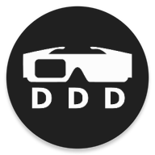
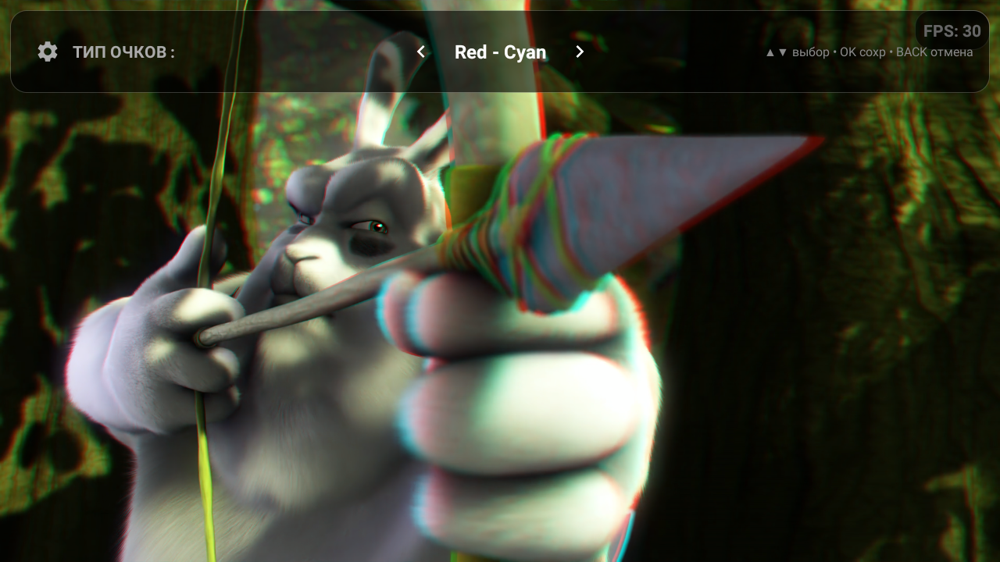
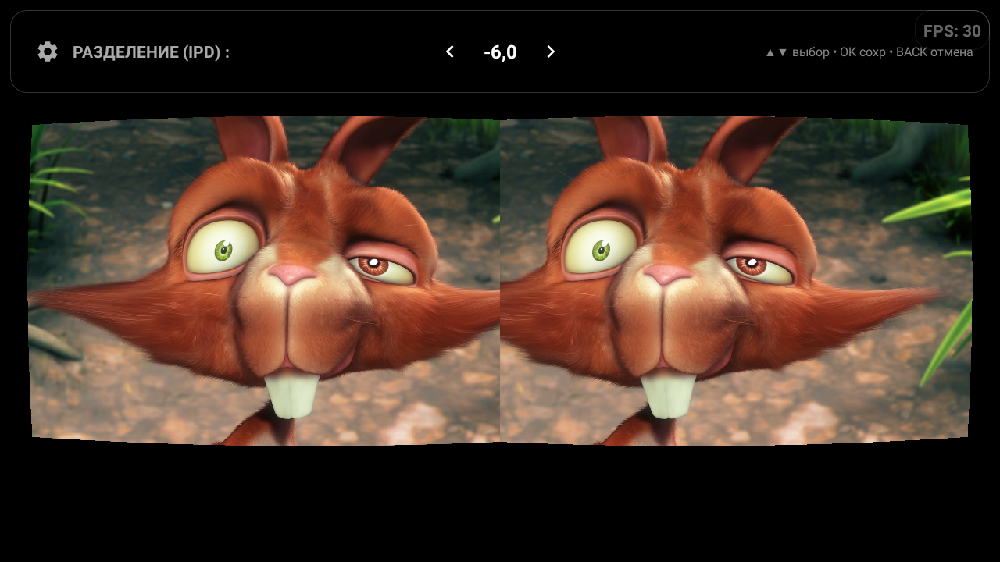
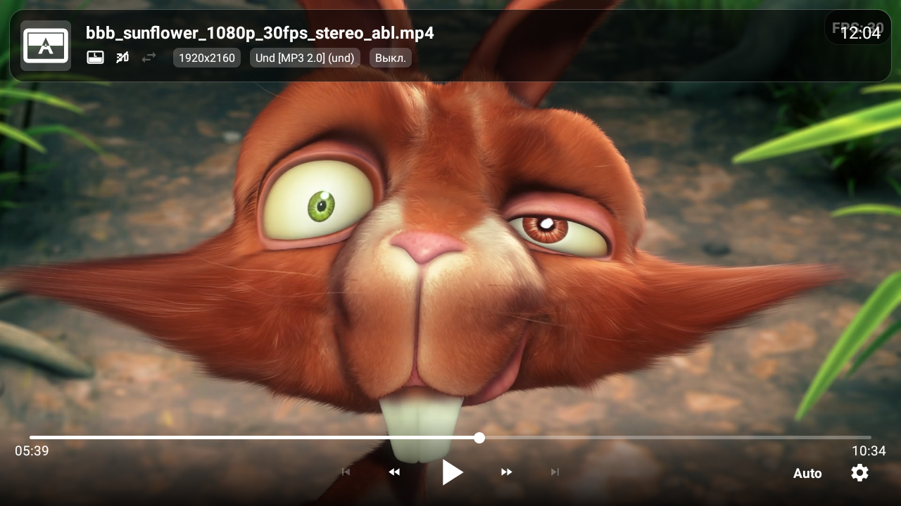

<div align="center">
  
  <h1>DDD Video Player</h1>

  <p>
    <a href="LICENSE">
      
    </a>
    <a href="https://github.com/usmanec/dddplayer/actions/workflows/android-build.yml">
      
    </a>
    <a href="README.md">
      
    </a>
  </p>

  <p>
    <b>Продвинутый 3D и HDR видеоплеер для Android TV и телефонов</b>
    <br>
    <i>Поддерживает Android 6.0 (API 23) и выше.</i>
  </p>
</div>

---

**DDD Video Player** — это продвинутый видеоплеер для Android (TV и телефонов), позволяющий просматривать не только обычное видео, но и стереоскопические видеопары, создавая эффект 3D.

Для получения 3D-эффекта потребуются **анаглиф-очки** (например, Красно-Синие) или оборудование типа **Cardboard VR**.

### Основные возможности

*   **Поддержка стереоформатов**:
    *   Горизонтальная стереопара: SBS и анаморфная HSBS (Half SBS)
    *   Вертикальная стереопара: OU и анаморфная HOU (Half OU)
    *   Чересстрочная стереопара (Interlaced)
    *   3D(z)Tiled (720p в 1080p)
    *   Автоопределение по метаданным контейнера и меткам в имени файла (`sbs`, `ou`, `tb`, ...).
*   **Режимы вывода**:
    *   **Анаглиф**: Высококачественный алгоритм Дюбуа с настраиваемыми матрицами (Красно-Голубой, Зелено-Малиновый, Желто-Синий, Красно-Синий).
    *   **VR / Cardboard**: Коррекция дисторсии линз для VR-гарнитур, импорт профиля из QR-кода Cardboard.
    *   **Моно**: Просмотр 3D-контента в 2D (только левый или правый глаз).
*   **Рендеринг**: Шейдеры OpenGL ES 3.0 со смешиванием анаглифа в линейном пространстве и автоматическим откатом на OpenGL ES 2.0 (можно включить принудительно в настройках).
*   **Поддержка HDR**: Прямой рендеринг через SurfaceView для нативного воспроизведения HDR / Dolby Vision на поддерживаемых экранах (в 2D режиме). Режим совместимости Dolby Vision → HEVC и опция игнорировать динамические метаданные HDR10+ (играть как HDR10).
*   **Звук**: Проброс 5.1 (AC3/DTS) на ресиверы через HDMI/Optical, встроенные аудиодекодеры FFmpeg, даунмикс в стерео с настраиваемым микшером, усиление громкости, пропуск тишины.
*   **Субтитры**: Корректное отображение субтитров в 3D-режимах; внешние субтитры через Intent, из файлов рядом с локальным видео (`movie.srt`, `movie.ru.srt`) или загрузкой из файла в меню субтитров; настраиваемый стиль (шрифт, размер, цвета, фон, обводка, положение) с предпросмотром.
*   **Плейлисты и IPTV**:
    *   Плейлисты из других приложений (см. Intent API) с постерами и субтитрами.
    *   Плейлисты M3U / M3U8 с группами (`group-title`, `#EXTGRP`), логотипами и HTTP-заголовками для каналов (`#EXTVLCOPT`, `#EXTHTTP`). HLS-потоки распознаются и воспроизводятся без повторного запроса.
    *   Стартовый экран: продолжить просмотр, сохраненные ссылки на плейлисты (M3U/IPTV) и встроенный файловый браузер (внутренняя память, SD-карты, USB-диски, сетевые папки SMB, медиасерверы DLNA); восстановление последнего канала M3U.
    *   Опциональный **эфирный режим** для плейлистов с live-потоками: OK — список каналов, Влево/Вправо — переключение каналов, Вверх — инфопанель.
*   **Воспроизведение**:
    *   Продолжение просмотра (спрашивать / всегда / никогда), опциональный запрос для позиции, переданной другим приложением.
    *   Настраиваемый размер сетевого буфера в МБ (ограничен доступной памятью), индикатор буфера.
    *   Auto Frame Rate (AFR): переключение частоты обновления экрана (и при желании разрешения) под видео.
    *   Картинка в картинке (PiP), опционально автоматически.
    *   Принудительное соотношение сторон (4:3, 16:9, 1.85, 2.35, 2.39), режимы вписать / обрезать / растянуть / ручной зум.
    *   Скорость воспроизведения, выбор аудиодорожек и субтитров с предпочитаемыми языками.
*   **Интерфейс для ТВ**: управление с пульта, настраиваемые кнопки OK/Вверх, часы на экране, подтверждение выхода, затемнение на паузе для OLED; жесты на телефонах (перемотка, громкость, яркость, свайп по плейлисту, масштаб и сдвиг картинки двумя пальцами).
*   **Настройки**:
    *   Регулировка глубины 3D (параллакс).
    *   Смена глаз местами (L/R Swap).
    *   Тонкая настройка цветов анаглифа (Оттенок, Утечка).
    *   Параметры линз VR (K1, K2, Масштаб).
*   **Визарды калибровки** Cardboard VR (разнос экранов, искажение линз, масштаб) и анаглиф-очков (цвета и порядок линз, двоение, оттенки) на сгенерированных тестовых картинках; сброс к значениям по умолчанию.
*   **Встроенное обновление** из GitHub Releases.
*   **Языки**: русский, английский, украинский, белорусский, китайский (упрощенный).

### Скриншоты

|                Анаглиф                | Cardboard VR |           Обычный плеер           |
|:-------------------------------------:|:---:|:---------------------------------:|
|  |  |  |

### Ссылки на последний релиз:
- [Страница релиза](https://github.com/usmanec/dddplayer/releases/latest)
- [Прямая ссылка на загрузку APK](https://github.com/usmanec/dddplayer/releases/latest/download/app-release.apk)

### Intent API (Интеграция)

Вы можете запускать DDD Player из сторонних приложений, используя `Intent.ACTION_VIEW`.

#### Базовый запуск (Одно видео)
```kotlin
val intent = Intent(Intent.ACTION_VIEW)
intent.setDataAndType(Uri.parse("https://example.com/video.mp4"), "video/*")
intent.setPackage("top.rootu.dddplayer") // необязательно: без выбора приложения
intent.putExtra("title", "Название фильма")
intent.putExtra("thumbnail", "https://example.com/poster.jpg")
intent.putExtra("position", 60_000L) // старт с 1:00
startActivity(intent)
```

Одиночная ссылка на `.m3u`/`.m3u8` проверяется автоматически: список каналов M3U открывается как плейлист, HLS-поток — как видео.

#### Поддерживаемые параметры (Extras)

| Ключ | Тип | Описание |
| :--- | :--- | :--- |
| `title` | String | Заголовок видео в интерфейсе (также принимается `android.intent.extra.TITLE`). Если его нет, используется имя файла. |
| `thumbnail` | String | Ссылка на изображение постера. |
| `position` | Long / Int / String | Позиция старта в миллисекундах. В зависимости от настройки «Позиция из другого приложения» применяется сразу (по умолчанию) или предлагается в диалоге продолжения. |
| `headers` | String[] | HTTP заголовки массивом: `["Key1", "Val1", "Key2", "Val2"]`. |
| `return_result`| Boolean | Если true, плеер вернет результат просмотра в вызывающее приложение (см. ниже). |

#### Субтитры (Одно видео)
Для добавления внешних субтитров к одиночному видео используйте следующие параметры:

| Ключ | Тип | Описание |
| :--- | :--- | :--- |
| `subs` | Parcelable[] (Uri) | Массив Uri ссылок на файлы субтитров. |
| `subs.name` | String[] | Массив названий (например, "Русский", "English"). |
| `subs.filename` | String[] | Массив имен файлов (опционально). |

**Пример:**
```kotlin
val subUris = arrayOf(Uri.parse(".../sub_ru.srt"), Uri.parse(".../sub_en.srt"))
val subNames = arrayOf("Русский", "English")
intent.putExtra("subs", subUris)
intent.putExtra("subs.name", subNames)
```

#### Поддержка плейлистов
Для передачи плейлиста используйте extra `video_list` (ParcelableArray of URIs) вместе с параллельными массивами метаданных.

| Ключ | Тип | Описание |
| :--- | :--- | :--- |
| `video_list` | Parcelable[] (Uri) | **Обязательно.** Список ссылок на видео (также принимается `ArrayList<String>`). |
| `video_list.name` | String[] | Список названий. |
| `video_list.filename` | String[] | Список имен файлов (используются как названия, если их нет). |
| `video_list.thumbnail` | String[] | Список ссылок на постеры. |
| `video_list.subtitles` | ArrayList&lt;Bundle&gt; | Список субтитров для каждого элемента плейлиста. |
| `start_index` | Int | Запасной индекс стартового элемента: используется, только если data интента не совпала ни с одним элементом (иначе первый элемент). |
| `headers` | String[] | HTTP заголовки для всех элементов. |
| `position` | Long / Int / String | Позиция старта для элемента, URI которого совпадает с data интента. |

**Стартовый элемент:** воспроизведение начинается с элемента, URI которого совпадает с data интента (`setDataAndType`). `start_index` — только запасной вариант, если data не задана или не найдена в списке; если нет ни того, ни другого, играет первый элемент.

**Структура субтитров в плейлисте:**
Параметр `video_list.subtitles` — это `ArrayList`, содержащий объекты `Bundle`. Каждый `Bundle` соответствует видео с тем же индексом в плейлисте.
Внутри каждого Bundle используются ключи:
*   `uris`: Parcelable[] (Uri) - Файлы субтитров.
*   `names`: String[] - Названия языков.

**Пример (Плейлист):**
```kotlin
val videoUris = arrayOf(Uri.parse(".../vid1.mp4"), Uri.parse(".../vid2.mp4"))
val titles = arrayOf("Фильм 1", "Фильм 2")

// Субтитры для Видео 1
val subs1 = Bundle()
subs1.putParcelableArray("uris", arrayOf(Uri.parse(".../vid1_sub.srt")))
subs1.putStringArray("names", arrayOf("Русский"))

// Субтитры для Видео 2 (без субтитров)
val subs2 = Bundle() 

val subsList = ArrayList<Bundle>()
subsList.add(subs1)
subsList.add(subs2)

// Начать с "Фильм 2": стартовый элемент задается data интента
intent.setDataAndType(videoUris[1], "video/*")
intent.putExtra("video_list", videoUris)
intent.putExtra("video_list.name", titles)
intent.putParcelableArrayListExtra("video_list.subtitles", subsList)
```

#### Результат просмотра
Если плеер запущен через `startActivityForResult` с `return_result = true`, при закрытии он вернет `RESULT_OK` и:

| Ключ | Тип | Описание |
| :--- | :--- | :--- |
| `data` | Uri | URI текущего (последнего воспроизведенного) элемента. |
| `position` | Long | Позиция в миллисекундах (при досмотре равна длительности). |
| `duration` | Long | Длительность видео в миллисекундах (0, если неизвестна, например эфир). |
| `end_by` | String | `completion` — видео досмотрено (плеер закрывается сам), `user` — пользователь вышел. |

### Технологии

*   **Язык**: Kotlin
*   **Ядро плеера**: Media3 (ExoPlayer) 1.9 с HLS, DASH, SmoothStreaming и RTSP; расширения FFmpeg (аудио) и AV1
*   **Сеть**: OkHttp
*   **Рендеринг**: OpenGL ES 3.0 / 2.0 (кастомные шейдеры для 3D/Анаглифа/VR), SurfaceView для 2D/HDR
*   **UI**: Android Views, ConstraintLayout, Leanback
*   **Загрузка изображений**: Coil
*   **База данных**: Room
*   **Архитектура**: MVVM (ViewModel, LiveData, Coroutines)

### Сборка

*   Требуется JDK 17 и Android SDK (compileSdk 36). Минимальная версия Android — 6.0 (API 23).
*   Юнит-тесты: `./gradlew testDebugUnitTest` (JUnit + Robolectric).
*   Debug-сборка: `./gradlew assembleDebug`, APK появится в `app/build/outputs/apk/debug/`.
*   Версия берется из git (`versionCode` — число коммитов, `versionName` — `git describe --tags`), поэтому клонируйте репозиторий с полной историей.
*   Каждый push и pull request в `main` собирается в [GitHub Actions](https://github.com/usmanec/dddplayer/actions/workflows/android-build.yml), debug APK прикладывается к запуску как артефакт.
*   Релизы публикует [workflow Release](.github/workflows/release.yml) при пуше тега `vX.Y.Z`: он собирает подписанный `app-release.apk` и прикладывает его к GitHub Release (оттуда же обновляется приложение). Подпись берется из переменных окружения `KEYSTORE_FILE` (путь относительно `app/`), `KEYSTORE_PASSWORD`, `RELEASE_SIGN_KEY_ALIAS` и `RELEASE_SIGN_KEY_PASSWORD`; без них релиз собирается неподписанным.
*   AAR декодеров FFmpeg и AV1 и AAR конвертации Dolby Vision (`lib-dovi-release.aar`, модуль `dovi`, сборка `./gradlew -Pdovi=true :dovi:assembleRelease`) в `app/libs` уже собраны; как пересобрать — в [app/libs/README.md](app/libs/README.md).
*   Документация для разработчиков: [AGENTS.md](AGENTS.md) и [docs/](docs/README.md).

### Вклад в проект и Обратная связь

Мы приветствуем участие сообщества в развитии проекта! Не стесняйтесь вносить изменения, исправлять ошибки или предлагать новые функции.

*   **Сообщения об ошибках**: Нашли баг? Пожалуйста, создайте [Issue](https://github.com/usmanec/dddplayer/issues) на GitHub.
*   **Pull Requests**: Хотите улучшить код? Форкните репозиторий, внесите изменения и отправьте Pull Request. Мы рады любым улучшениям!
*   **Идеи**: Есть предложения? Давайте обсудим их в разделе Issues.

### Лицензия

Этот проект распространяется под лицензией **GNU General Public License v3.0 (GPLv3)**.

Подробности смотрите в файле [LICENSE](LICENSE).